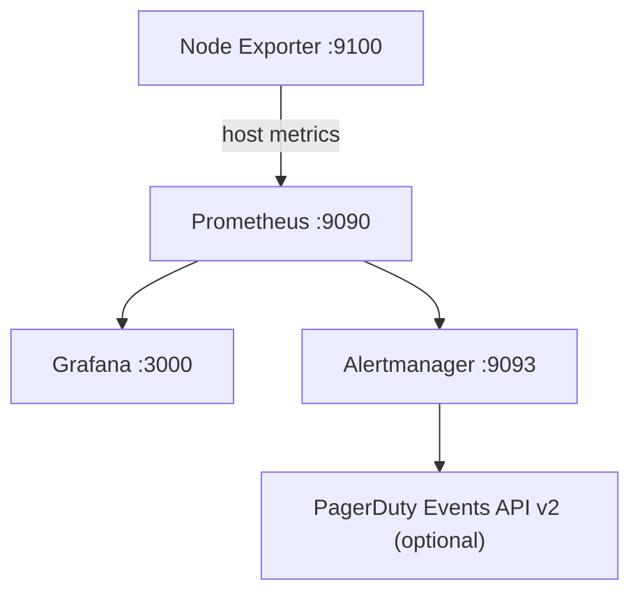

# Monitoring Stack: Prometheus, Grafana, Node Exporter, Alertmanager and PagerDuty

This repository follows the same tutorial-style, single-EC2 layout as the reference project:
- `node.sh` installs Node Exporter.
- `grafna-promethous.sh` installs Prometheus, Grafana and Alertmanager.
- `configure-pagerduty.sh` optionally configures PagerDuty without storing the key in GitHub.

## Architecture

All four open-source components run on the **same Ubuntu EC2 instance** for this tutorial setup.



## Prerequisites

- Ubuntu EC2 (amd64 or arm64)
- Outbound internet access
- Security Group: TCP 22 from your IP; TCP 3000, 9090 and 9093 from your IP only.
- Do not expose TCP 9100 publicly.

## Install

Clone your own repository:

```bash
sudo apt-get update
sudo apt-get install -y git
git clone https://github.com/YOUR_USERNAME/YOUR_REPOSITORY.git
cd YOUR_REPOSITORY
chmod +x node.sh grafna-promethous.sh configure-pagerduty.sh
```

Start Node Exporter:

```bash
sudo bash node.sh
```

Install Prometheus, Grafana and Alertmanager:

```bash
sudo bash grafna-promethous.sh
```

## Access

- Node Exporter metrics: `http://EC2-PUBLIC-IP:9100/metrics` (prefer localhost/private access; do not open this port publicly)
- Prometheus: `http://EC2-PUBLIC-IP:9090`
- Grafana: `http://EC2-PUBLIC-IP:3000`
- Alertmanager: `http://EC2-PUBLIC-IP:9093`

Grafana initial login: `admin` / `admin`. Change the password at first login.

## Grafana dashboard

1. Open Grafana.
2. Add Prometheus data source.
3. URL: `http://localhost:9090`.
4. Save & test.
5. Import dashboard ID `1860` (Node Exporter Full).

## PagerDuty (optional)

Create a PagerDuty service using Events API v2. If any previous routing key was exposed in a script or public repository, revoke/rotate it first. Then run:

```bash
sudo bash configure-pagerduty.sh
```

The script prompts for the new key without echoing it and stores it outside the Git repository. Never commit routing keys.

## Basic PromQL

CPU usage %:

```promql
100 - (avg by(instance) (rate(node_cpu_seconds_total{mode="idle"}[5m])) * 100)
```

Memory usage %:

```promql
100 * (1 - node_memory_MemAvailable_bytes / node_memory_MemTotal_bytes)
```

Disk usage %:

```promql
100 * (1 - node_filesystem_avail_bytes{fstype!~"tmpfs|overlay"} / node_filesystem_size_bytes{fstype!~"tmpfs|overlay"})
```

Load average:

```promql
node_load1
```

Incoming network:

```promql
rate(node_network_receive_bytes_total[5m])
```

Outgoing network:

```promql
rate(node_network_transmit_bytes_total[5m])
```

## Stress test

Use only on a lab EC2:

```bash
sudo apt-get install -y stress-ng
stress-ng --cpu 2 --timeout 300
```

Watch CPU usage in Grafana.

## Verify services

```bash
sudo systemctl is-active node_exporter
sudo systemctl is-active prometheus
sudo systemctl is-active grafana-server
sudo systemctl is-active alertmanager
```

Logs:

```bash
sudo journalctl -u node_exporter -n 50 --no-pager
sudo journalctl -u prometheus -n 50 --no-pager
sudo journalctl -u grafana-server -n 50 --no-pager
sudo journalctl -u alertmanager -n 50 --no-pager
```

## Important

This is a tutorial/learning setup on one EC2, not a highly available production design. The reference tutorial's basic flow is preserved while using systemd services, signed Grafana APT repository configuration, validation, and safer secret handling.
